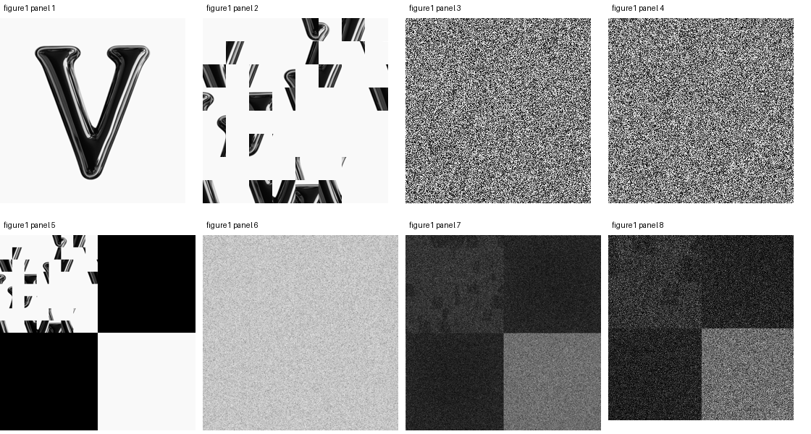
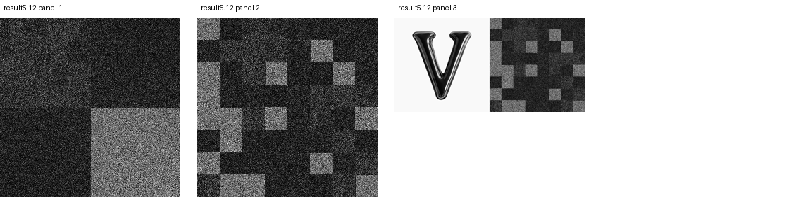

# JTC Optical Image Encryption

**Optical image encryption with a joint transform correlator**  
Undergraduate project · Ziyang Shen · MATLAB / Fourier optics / image processing

A MATLAB simulation study combining block scrambling, random phase modulation and a joint transform correlator (JTC). This repository preserves the original MATLAB figure results and provides a separate analysis script to inspect and verify them.

> Status: archived simulation results with verified numerical metrics. The saved recovery output does not reconstruct a recognizable original image. This repository does not claim production cryptographic security or validated authentication performance.


## Method

1. Resize the input image to 256 × 256 pixels.
2. Divide it into 64 blocks of 32 × 32 pixels and permute their positions.
3. Modulate the scrambled image with a random phase mask.
4. Place the modulated image and a reference phase mask in opposite quadrants of a 512 × 512 joint input.
5. Compute the joint power spectrum as the encrypted signal.
6. Perform frequency-domain correlation with the reference key, crop the output and apply inverse block scrambling.

## Saved results



Panels 1–8: input; block scrambling; phase mask 1; phase mask 2; joint-input magnitude; displayed ciphertext; full correlation magnitude; cropped, normalized correlation output.



The second figure contains the scrambled recovery, inverse-scrambled recovery and original/recovery comparison.

| Metric | Recomputed value |
|---|---:|
| Mean squared error | 0.5137303998 |
| PSNR, with a nominal peak value of 1 | 2.8926473433 dB |
| Pearson correlation | 0.0676399224 |

Metrics use the original floating-point CData and recovered CData directly. The stored input includes slight values outside [0,1]; no additional clipping or rescaling is applied in this calculation. These metrics match the thesis table to its reported precision and show limited reconstruction quality.

## Inspect in MATLAB

The thesis reports MATLAB R2017a as its simulation environment. The following viewer is newly prepared for this repository; it is not the original encryption source code.

```matlab
addpath('matlab');
inspect_results
```

For independent analysis in Python:

```bash
python -m pip install -r requirements.txt
python tools/verify_results.py
```

The Python script reads MATLAB graphics data with SciPy, recomputes metrics and checks the joint input, displayed ciphertext, correlation calculation, crop and inverse block arrangement. It does not execute callbacks stored in figure files.

## Files

| Path | Contents |
|---|---|
| `results/figure1.fig` | Original eight-panel MATLAB figure |
| `results/result5.12.fig` | Original three-panel recovery figure |
| `assets/` | Supplied V, A and square test images |
| `matlab/inspect_results.m` | Viewer and metric calculation helper |
| `tools/verify_results.py` | Independent numerical verification |
| `docs/` | Previews rendered from saved CData |

## Scope and limitations

- Original `.m` simulation source has not been supplied. The analysis helpers are additions, not recovered original source.
- The saved ciphertext display is min–max normalized `log(1 + E)`, rather than the raw power spectrum used by correlation.
- The cropped recovery is normalized to [0,1]. Its maximum of 1 is therefore not by itself evidence of successful key authentication.
- The phase arrays contain 65,536 distinct values each. An implemented 8-bit quantization step is not established by these saved results.
- Random-key attack trials, authentication thresholds and false-accept/false-reject statistics are not stored in these two figure files.
- The previews use English panel identifiers and do not reproduce the MATLAB window styling.


